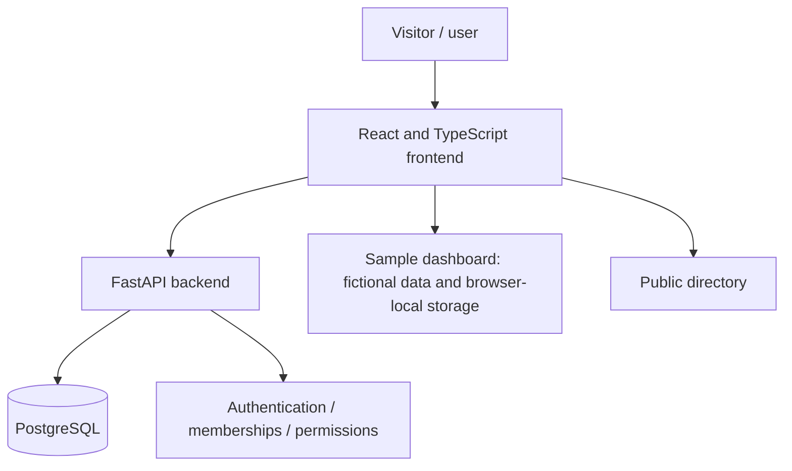

# Vínculo | Conceptual Architecture

This diagram summarizes the architecture documented by the private project. It is **not** a security audit or a guarantee that every flow has been validated in production.



## Components and responsibilities

| Component | Responsibility |
|---|---|
| React and TypeScript | Browser interface and interactions |
| FastAPI | Account, membership and administrative APIs |
| PostgreSQL | Persistent account, membership and API-managed records |
| Browser localStorage | Selected demonstration interactions that are not shared across users |
| Render | Hosting for separate website and API services, with a PostgreSQL resource |

## Important boundaries

- A donation entry is a **manual record**, not a payment-processing transaction.
- The sample dashboard is not a fully shared administration system.
- Account registration does not automatically grant organization permissions.
- Email verification has not been implemented.
- The prototype should only be tested using fictional information.
- Secrets and database credentials are not included in this public repository.

## Information flow

```text
Visitor → Directory and filters
User → Registration / authentication → API → PostgreSQL
Authorized member → Administrative operations → API → PostgreSQL
Demo visitor → Sample dashboard → Local browser data
```

## Documented deployment

- [Public web demo](https://vinculo-donantes-1.onrender.com/)
- API hosted separately on Render
- PostgreSQL connected to the API

**Operational note:** The source project's documentation states that a free PostgreSQL instance expires on **November 18, 2026**. Service continuity may require a plan change or migration. This portfolio does not guarantee uptime.

**Source privacy:** Keeping a repository private protects its Git history and stored files from public repository access. Frontend resources delivered to a web browser, however, remain inspectable. Confidential business logic must be kept on the server.
