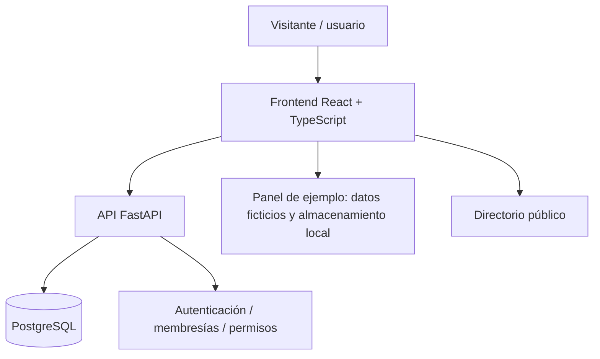

# Arquitectura conceptual de Vínculo

La siguiente vista representa la arquitectura descrita por el proyecto privado; no documenta una auditoría de seguridad ni garantiza que todos los flujos estén validados en producción.



## Responsabilidades

| Componente | Responsabilidad |
|---|---|
| React + TypeScript | Presentación e interacción en navegador |
| FastAPI | Endpoints de cuenta, membresías y registros administrativos |
| PostgreSQL | Persistencia de cuentas, membresías y datos registrados mediante API |
| localStorage del navegador | Algunas operaciones de demostración que no se sincronizan |
| Render | Hosting separado de sitio web y API, con base PostgreSQL |

## Límites importantes

- Las donaciones registradas en la aplicación son **registros manuales**, no transacciones con procesador de pagos.
- El panel de ejemplo no es una interfaz de administración compartida con persistencia garantizada.
- El acceso está asociado a membresías y permisos; registrar una cuenta no concede derechos automáticamente.
- El correo de verificación no está implementado.
- La aplicación requiere datos ficticios de prueba.
- Los secretos y cadenas de conexión permanecen fuera del portafolio público.

## Flujo de información

```text
Visitante -> Directorio / filtros
Usuario -> Registro e inicio de sesión -> API -> PostgreSQL
Usuario con membresía -> Operaciones autorizadas -> API -> PostgreSQL
Exploración de demostración -> Panel de ejemplo -> Navegador local
```

## Despliegue documentado

- Web: https://vinculo-donantes-1.onrender.com/
- API: servicio independiente en Render
- Base: PostgreSQL conectada con la API

**Aviso operacional:** la documentación del proyecto original indica que una instancia gratuita de base de datos tiene vencimiento el 18 de noviembre de 2026. El funcionamiento posterior requerirá revisar el plan o migrar los datos. Este portafolio no garantiza disponibilidad continua.

**Privacidad del código:** un repositorio privado oculta el historial y los archivos almacenados ahí, pero los archivos frontend enviados al navegador de un visitante pueden ser inspeccionados. Si hay lógica verdaderamente confidencial, debe permanecer en el servidor.
